# CST8912 Graded Lab Activity 3

## Azure Storage Account and Shared Access Signatures

**Name:** Samuel Vachon  
**Student Number:** 041101891  
**Section:** CST8912_013  
**Date:** October 9, 2026

## Objective

The objective of this lab was to configure an Azure Storage Account, explore redundancy and access tiers, upload a private blob, generate and test a Shared Access Signature (SAS), and create a lifecycle management rule.

## Configuration Summary

| Setting                          | Value                     |
| -------------------------------- | ------------------------- |
| Subscription                     | MOC DS - 10290            |
| Resource group                   | CST8912-demo              |
| Storage account                  | labtest8912sv041101891    |
| Region                           | Canada Central            |
| Performance                      | Standard                  |
| Account kind                     | StorageV2                 |
| Corrected geo-redundancy setting | GRS                       |
| Final redundancy before cleanup  | LRS                       |
| Default blob access tier         | Cool                      |
| Container                        | labtestcontainer8912      |
| Container access level           | Private                   |
| Blob path                        | sampletest8912/grades.csv |
| Blob type                        | Block blob                |
| Individual blob access tier      | Hot                       |
| SAS permissions                  | Read                      |
| SAS protocol                     | HTTPS only                |
| Lifecycle rule                   | myrule8912                |

## 1. Storage Account Creation

I created the storage account in Canada Central using the resource group `CST8912-demo`. I used Standard performance and kept the networking and data protection settings at their defaults.

I used the storage account name `labtest8912sv041101891` to provide a unique name.

The original creation settings used Read-access geo-redundant storage (RA-GRS). I later corrected the replication setting to GRS and then changed it back to LRS to meet the lab's final configuration.

### Creation Settings

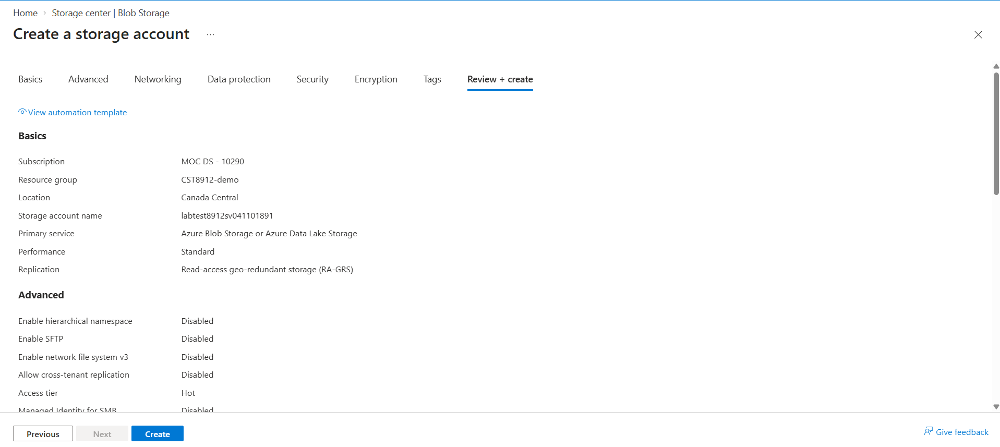

### Successful Deployment

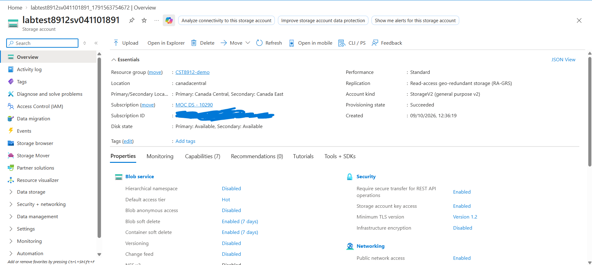

## 2. Redundancy Configuration

I corrected the account's replication setting to Geo-redundant storage (GRS). The overview showed Canada Central as the primary region and Canada East as the secondary region.

GRS provides replication to a secondary region. RA-GRS adds read access to the secondary region, which was not required for the main lab.

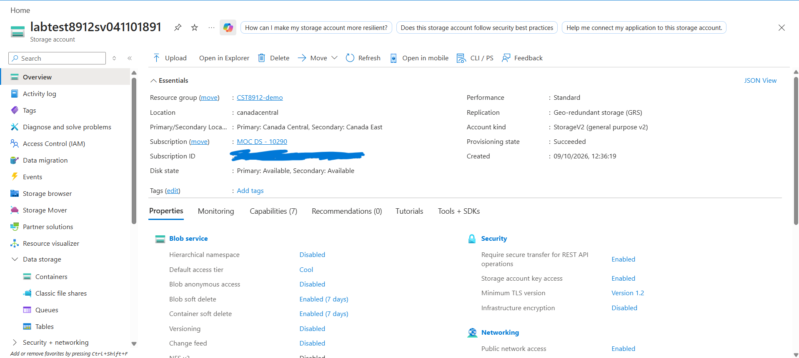

I then changed the redundancy from GRS to Locally redundant storage (LRS) and saved the change.

LRS maintains redundant copies within a single physical location in the primary region. It has a lower cost than geo-redundant storage, but it does not provide the same protection against a regional outage.

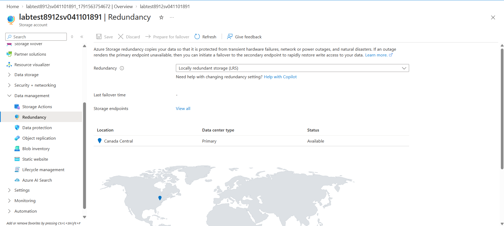

## 3. Default Access Tier

I opened the storage account's Configuration page, changed the default blob access tier to Cool, and saved the setting.

The Cool tier is intended for data that is accessed less frequently. It generally has lower storage costs and higher access costs than the Hot tier.

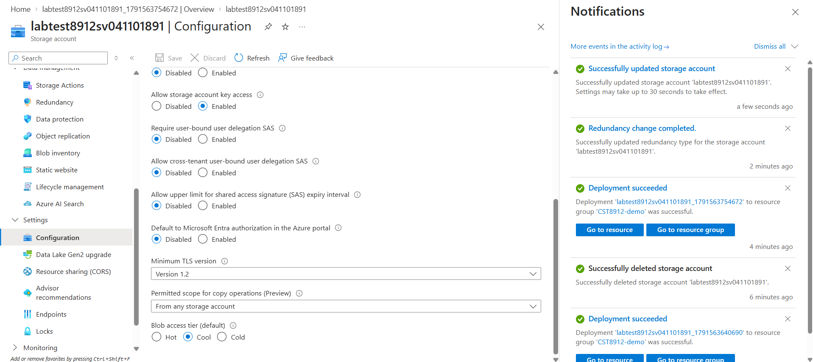

## 4. Private Container Creation

I created a container named `labtestcontainer8912` and kept its anonymous access level set to Private.

This prevents users from accessing the blobs anonymously through their URLs.

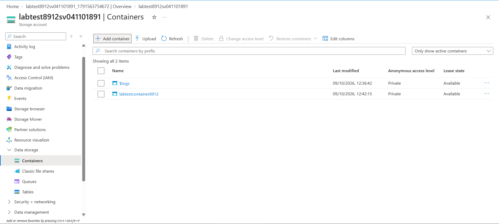

## 5. Blob Upload and Hot Tier

I downloaded `grades.csv` from the sample CSV website provided in the lab instructions.

I uploaded it as a block blob into the folder `sampletest8912` inside the container.

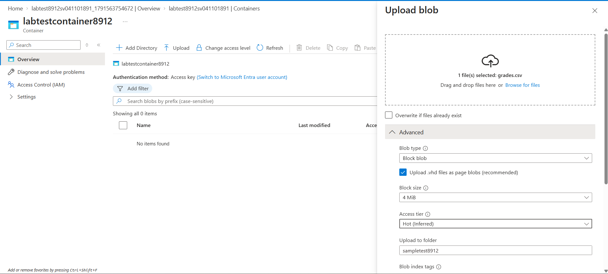

I confirmed that the uploaded blob used the Hot access tier. Although the account's default tier was Cool, the individual blob was explicitly set to Hot.

The Hot tier is suitable for frequently accessed data.

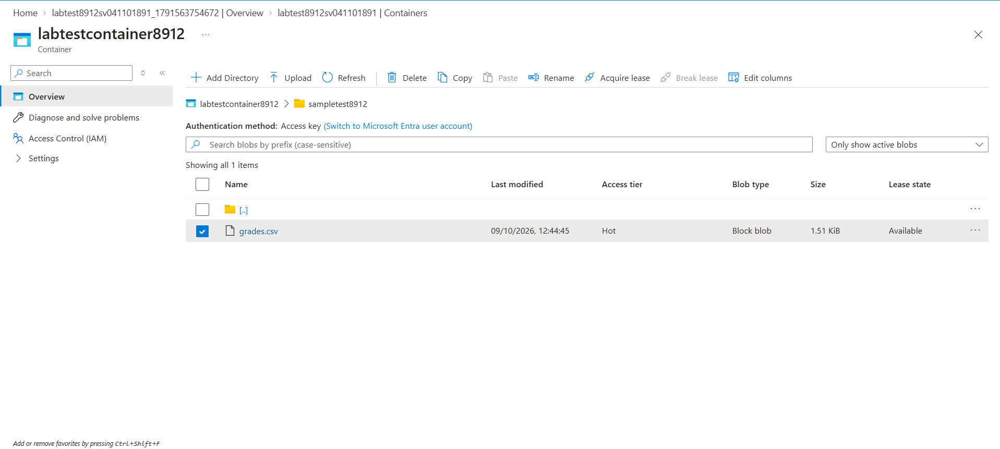

## 6. Private Access Test

I copied the plain blob URL and opened it in a private browser window without a SAS token.

The request failed with the error `PublicAccessNotPermitted`, stating that public access was not permitted on the storage account.

This confirmed that the file could not be accessed anonymously.

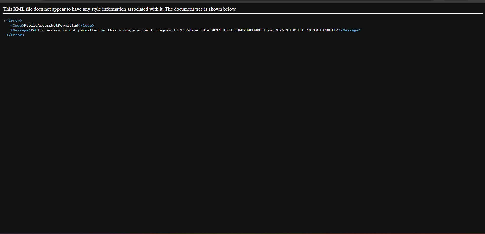

## 7. SAS Generation and Access Test

I generated a SAS for `sampletest8912/grades.csv` with Read permission, a defined start and expiry time, and HTTPS-only access.

The SAS allowed temporary access to this blob without changing the container's private access level.

The SAS token and URL were covered in the screenshot to avoid publishing the access credentials.

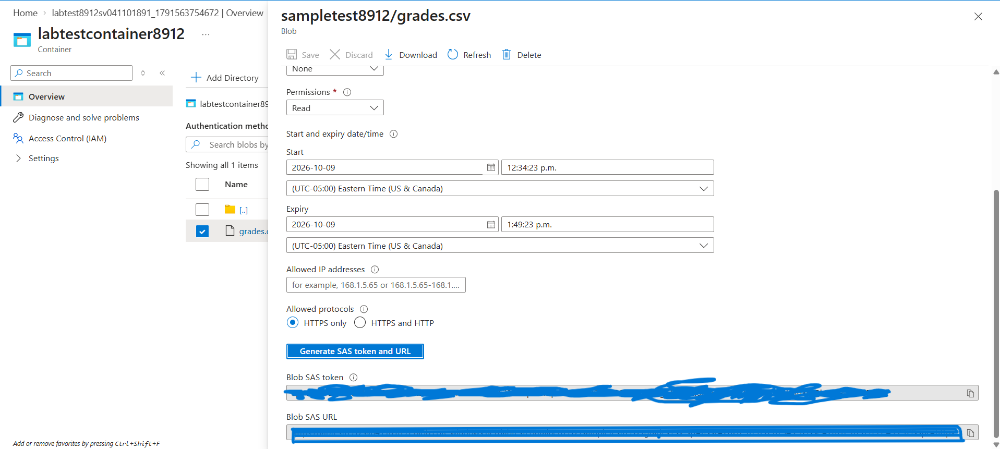

I pasted the complete Blob SAS URL into the private browser window. The browser successfully downloaded the CSV and showed its download status as Done.

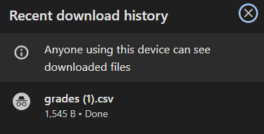

I opened the downloaded file in Excel to confirm that its contents were accessible.

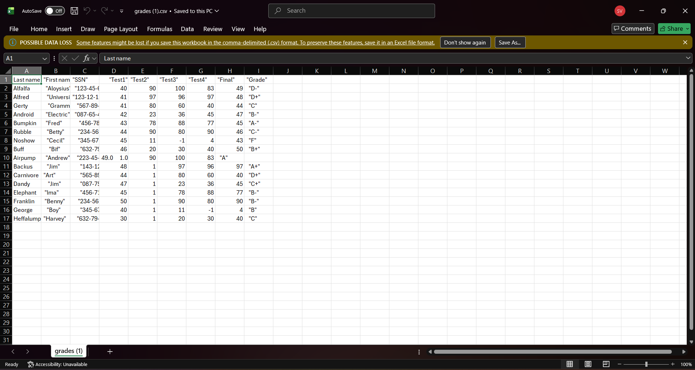

### Findings

The plain URL failed because anonymous access was disabled. The SAS URL succeeded because it included temporary authorization to read the blob.

This demonstrated how SAS can provide limited access while keeping a container private.

## 8. Lifecycle Management Rule

I created a lifecycle management rule named `myrule8912` at the storage account level.

| Rule setting  | Value                                |
| ------------- | ------------------------------------ |
| Scope         | Limit blobs with filters             |
| Blob type     | Block blobs                          |
| Blob subtype  | Base blobs                           |
| Condition     | Last modified more than 15 days ago  |
| Action        | Move to Cool storage                 |
| Prefix filter | labtestcontainer8912/sampletest8912/ |
| Status        | Enabled                              |

### Condition and Action

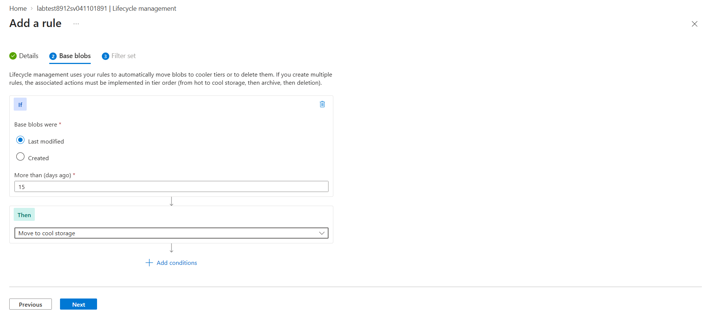

### Prefix Filter

The prefix filter limits the rule to blobs inside the `sampletest8912` folder in `labtestcontainer8912`.

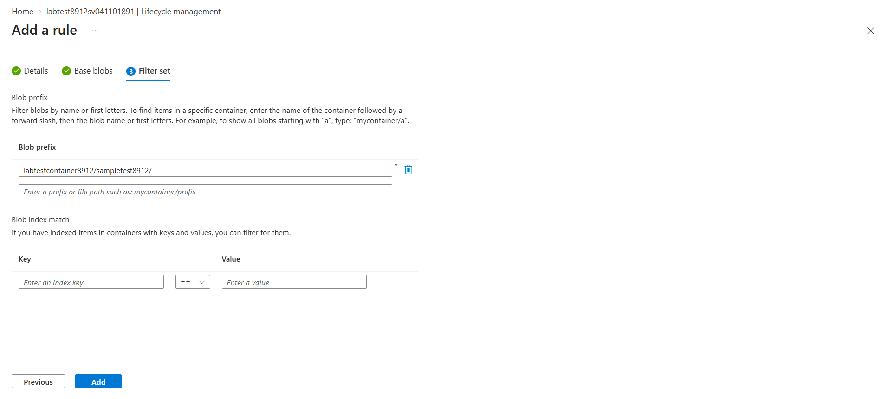

### Saved Rule

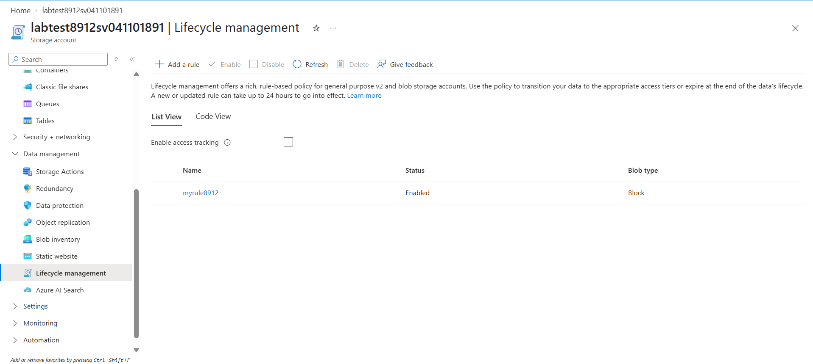

### Findings

The rule was configured to move matching base blobs to Cool storage once their last-modified age exceeded 15 days.

This can reduce storage costs for data that becomes less frequently accessed over time. I verified the saved rule but did not observe an automatic tier transition because the uploaded blob had not reached the required age.

## 9. Cleanup

After collecting the screenshots, I deleted the lab resources.

The cleanup screenshot shows zero resources in the lab resource view, and `CST8912-demo` is no longer listed in the resource-group list.

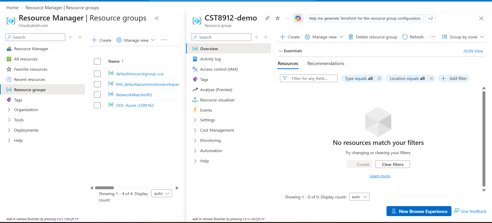

## Conclusion

This lab demonstrated how Azure Blob Storage combines redundancy, access tiers, private access, temporary SAS authorization, and lifecycle management.

I confirmed that anonymous access to the blob failed while access through a read-only SAS succeeded. I also configured an enabled lifecycle rule to move older blobs to Cool storage and removed the lab resources after completing the work.

## References

- [Sample CSV files](https://people.sc.fsu.edu/~jburkardt/data/csv/csv.html)
- [Azure Storage redundancy](https://learn.microsoft.com/en-us/azure/storage/common/storage-redundancy)
- [Shared Access Signatures overview](https://learn.microsoft.com/en-us/azure/storage/common/storage-sas-overview)
- [Configure lifecycle management policies](https://learn.microsoft.com/en-us/azure/storage/blobs/lifecycle-management-policy-configure)
